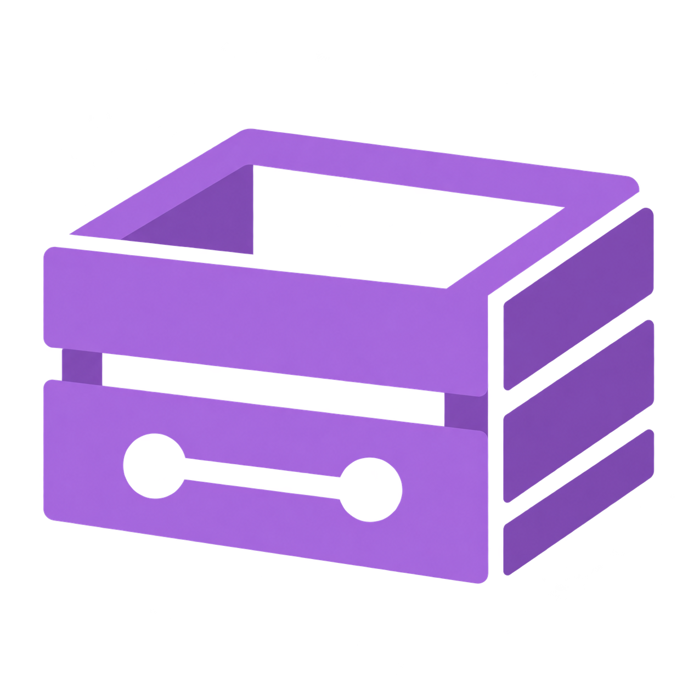

  

# NetCrate

NetCrate backs up Windows folders to a computer you control and optionally processes video proxies.

**NetCrate is experimental software.** Keep independent backups of important files. Real-machine acceptance remains incomplete. Read the [remaining issues and test plan](docs/experimental-roadmap.md) before trying it.

I’m a team of one working in commercial filmmaking and videography. I built NetCrate to keep a backup of my footage somewhere else and move proxy generation off my editing computer.

The idea is simple: another computer at another location, even one assembled from parts you already have, can do useful work while your main machine stays available for editing. You don’t necessarily need another powerful workstation.

For video projects, NetCrate backs up the originals, generates proxies and contact sheets on the other computer, verifies the results, and sends them back to your editing machine. You can monitor progress without managing every step yourself.

For someone with spare hardware and a suitable second location, it can be an affordable, self-hosted alternative to paying for cloud backup storage, with the added benefit of offloading proxy encoding.

## Development status

Version 0.2.0 development includes a guided Windows setup for an Editing Computer and a Backup Server. Setup reviews software before installation, shows progress, creates encrypted backup storage and helps save recovery details. Computers exchange pairing details over a private connection, with codes compared on both screens. The Editing Computer then verifies a generated sample backup and restore. Ordinary folder backups are the default; media processing is optional.

Setup uses Windows dialogs and buttons. For ordinary files, choose **Back up a folder** and select the configured source folder or a folder inside it. New backups are confirmed after their recovery receipt is published, independently of media processing. In media mode, choose **Back up a project**. The server also creates ProRes Proxy files and contact sheets, and the Editing Computer verifies the returned files before showing them as ready. Earlier proxy versions remain available. Existing installations keep their media workflow.

The guided workflow has been tested with disposable repositories and generated footage. Testing on two separate Windows computers, including sign-in after a restart and recovery under a fresh account, is still required before a supported binary release. Both computers must stay on and signed in while tasks run.

See [setting up both computers](docs/setup.md) for the user workflow and [development and verification](docs/development.md) for build instructions. There is no public release download yet.

## Versioning

NetCrate uses [Semantic Versioning](https://semver.org/). Patch releases fix bugs, minor releases add features, and major releases change compatibility. Builds in the 0.x series are experimental. See the [changelog](CHANGELOG.md) for unreleased changes. Releases receive a dated entry and an immutable `vX.Y.Z` tag. Windows metadata adds `.0`; each component is limited to 65534.

## License

NetCrate's original code is licensed under the [MIT License](LICENSE). Third-party software retains its own licenses.
